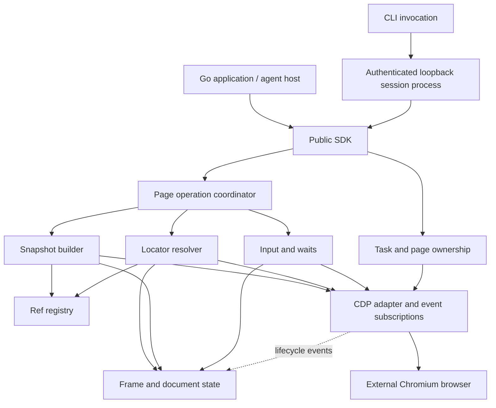

# cdp-q-driver 기반 블루프린트

상태: M1–M4 및 후속 CLI 구현·검증 완료 · 갱신일: 2026-11-07 (Asia/Seoul)

대상 독자는 이 저장소를 구현하거나 검토하는 개발자다. 이 문서는 프로젝트의 목적, 범위, 책임과 구현 순서를 관리한다. 현재 구현과 후속 설계를 구분하며 정확한 공개 API는 Go 코드와 해당 테스트가 소유한다. 목적, 주요 경계, 완료 기준이나 핵심 위험이 바뀌면 이 문서를 갱신한다.

## 1. 목적과 현재 상태

`cdp-q-driver`는 일반 Chromium 계열 브라우저를 CDP로 제어하는 Go 라이브러리를 목표로 한다. 에이전트와 Go 프로그램이 페이지를 의미 있는 텍스트로 관찰하고, 관찰한 요소를 ref로 지정해 조작하는 흐름을 제공한다.

```text
연결 → 작업 생성 → 페이지 관찰 → 요소 선택 → 입력 → 결과 확인 → 정리
```

핵심 가치는 명령 전송 자체보다 **관찰한 노드와 실제 입력 대상을 정확하게 연결하는 것**이다. Ego Lite의 에이전트용 API를 참고하되, 일반 Chromium에서 동작할 스냅샷·ref·프레임·입력 계층을 설계한다.

| 구분 | 현재 확인된 상태 |
| --- | --- |
| 저장소 | `github.com/snowmerak/cdp-q-driver` |
| Go 모듈 | 초기화 완료, `go.mod`의 Go 버전은 `1.27.3` |
| 구현 | M1 탭 수명, M2 관찰·입력, M3 iframe·OOPIF·open shadow DOM·subtree·text/role, M4 popup·dialog·파일·이벤트 구독·network idle, 실행 예제 4개 및 상태 유지 CLI 구현. `chromedp v0.23.0`·`cdproto v0.159.0` 사용 |
| 연구 | 공개 Ego SDK 분석과 설치된 Ego의 자체 HTML 실험 완료 |
| 검증 | Windows/ARM64, Go 1.27.3, Chrome 156.0.8078.80, CDP 1.3에서 실제 브라우저 통합 테스트 통과 |
| 검증 한계 | closed shadow root, 회전·기울임·원근·반전된 iframe은 미지원. 파일은 Chrome과 공유 경로가 필요하고 다운로드 정책은 default context 전체에 영향. idle은 attach 후 관측 요청만 추적하며 frame/session 변경 시 기존 대기를 실패 처리. 현재 플랫폼의 race detector는 미지원 |

근거와 외부 출처는 [Ego Lite 재구현 가능성 연구](research/ego-lite-cdp-feasibility.ko.md)에 모았다. 연구 문서는 관찰과 근거를 보존하고, 이 문서는 앞으로 구현할 프로젝트의 지도를 관리한다.

## 2. 사용자와 성공 조건

주 사용자는 Go 애플리케이션 개발자, 에이전트 실행기를 만드는 개발자, 터미널에서 브라우저를 조작하는 사용자다. 호출자가 브라우저와 작업의 수명을 제어하며, 모델 호출이나 업무별 성공 판단은 호출자에게 남긴다.

대표 흐름은 다음과 같다.

1. 호출자가 명시적으로 허용한 CDP endpoint에 연결한다.
2. 작업을 만들고 새 페이지를 열거나 외부 페이지를 명시적으로 편입한다.
3. 스냅샷에서 텍스트, 역할, 상태와 ref를 읽는다.
4. ref 또는 locator로 입력 대상을 선택해 `Fill`·`Click`을 실행한다.
5. URL, DOM 상태 또는 별도 대기로 업무 결과를 확인한다.
6. 작업을 종료하며 생성한 페이지를 정리하고 빌린 페이지는 반환한다.

첫 제품 범위의 성공은 자체 fixture에서 이 흐름을 수행하고, 탐색·중복 요소·iframe·timeout 상황에서도 다른 요소를 잘못 클릭하거나 액션을 중복 실행하지 않는 것이다. 액션 전송 성공을 업무 완료로 보고하지 않는다.

## 3. 범위

### 첫 제품 범위

- Go SDK: 연결, 작업, 페이지, 스냅샷, ref, locator, 액션, 대기와 정리.
- SDK는 기존 CDP endpoint에 연결한다. 후속 CLI는 `--chrome PATH`로 설치된 Chrome 실행·전용 지속 프로필·자동 CDP 준비도 제공한다. 브라우저 설치는 별도다.
- AX·DOM·레이아웃 정보를 조합한 텍스트 스냅샷과 구조화된 ref 목록.
- viewport·전체 페이지·subtree 관찰. 세부 범위는 단계별로 추가한다.
- ref·CSS부터 시작해 text·role locator로 확장.
- 이동, reload, 조회, 스크린샷, 클릭, focus, 텍스트 입력과 키 입력.
- iframe·OOPIF와 open shadow DOM에서의 요소 식별과 입력.
- 명시적인 대기, popup·JavaScript dialog·파일 업로드·다운로드 처리.
- 호출별 `context`와 전송 상태를 포함한 오류, 제한된 이벤트 구독.

첫 SDK 범위 이후 사용자 요청으로 루트의 `cmd/cdp-q-driver`에 CLI 실행 앱을 추가했다. 기존 루트 package와 SDK import 경로는 유지한다. 별도 호출 간 상태 유지와 동일 SDK 기능 제어를 제공하며 세부 명령·설정·실행 계약은 [영문 CLI 가이드](cli.md)에 있다.

### 첫 제품 이후 후보

- CLI의 crash recovery, 작업·페이지 소유권의 영속 ledger와 재개.
- 브라우저 자동 설치와 사용자 기본 프로필 선택·이전.
- 독립 BrowserContext를 이용한 작업별 저장소 격리.
- 협력적 handoff와 재개, UI 또는 확장 기능을 통한 사용자 제어 연동.
- 고급 drag-and-drop, rich clipboard와 OS별 입력 기능.

### 현재 목표에 포함하지 않는 항목

- Chromium 포크, Ego의 네이티브 스냅샷과 브라우저 UI의 완전한 재현.
- 기존 `ego-browser nodejs` 및 Node 모듈 실행 호환성.
- WebDriver, Firefox·WebKit 지원, LLM 실행·계획·사이트별 업무 자동화.
- 임의 사용자 프로필의 자동 발견·이전과 로그인 상태의 자동 복원.
- canvas나 닫힌 shadow root에서 DOM 수준의 의미·ref 품질 보장.

## 4. 기본 설계 방향

아래는 설계의 기본 선택이다. M1–M4의 수명·관찰·입력·프레임·이벤트·파일 워크플로와 후속 CLI가 구현됐다. 실제 제약이 확인되면 이유와 영향을 기록하고 수정한다.

| 선택 | 이유와 영향 |
| --- | --- |
| Go SDK와 이를 재사용하는 CLI | SDK는 서버 없이 사용한다. CLI는 호출 간 ref·소유권을 유지하는 로컬 제어 프로세스를 별도로 실행한다. |
| `chromedp`·`cdproto` 기반 CDP 어댑터를 우선 검증 | transport·타입·세션 기능을 재사용한다. 정확한 버전은 첫 연결 검증에서 고정한다. |
| 공개 API에서 CDP 라이브러리 타입을 감춘다 | snapshot·ref·action 의미를 프로젝트가 소유한다. |
| Go에서 orchestration, 페이지에서는 필요한 JS 함수 실행 | 호스트 Node 없이 DOM 상태·좌표·편집 동작을 처리한다. |
| 작업과 저장소 정책을 분리 | 탭 소유권과 쿠키·저장소 격리를 같은 개념으로 취급하지 않는다. |
| 잘못된 대상보다 명시적인 실패를 선택 | stale ref를 이름이 비슷한 다른 요소로 대체하지 않는다. |
| 브라우저 상태를 실제 상태의 기준으로 사용 | 로컬 ref·frame·target 레지스트리는 연결이 끊긴 뒤 신뢰할 수 없다. |

하부 라이브러리 API와 버전 차이는 [연구 문서의 Go 구현 방향](research/ego-lite-cdp-feasibility.ko.md#go-구현-방향)을 참고한다. M1은 `chromedp v0.23.0`·`cdproto v0.159.0`으로 고정했다. 대상의 이벤트 처리는 Page 수명 context로 초기화하고 개별 호출의 timeout과 분리했다.

## 5. 구조와 책임

다음은 제안 구조다. 첫 구현은 한 프로세스에 배치한다.



| 구성 | 소유하는 책임 | 경계 |
| --- | --- | --- |
| 공개 SDK | Browser·Task·Page 핸들, 옵션, 결과와 오류 | 내부 session·object ID를 일반 API에 노출하지 않는다. |
| 작업·페이지 관리 | 생성·편입·반환, 페이지 출처, 정리 정책 | 작업 라벨과 browser target ID를 구분한다. |
| 페이지 조정자 | 페이지 작업 순서, 취소·deadline, 관찰과 액션의 상태 검증 | 성공·실패와 실제 전송 상태를 함께 정리한다. |
| 프레임 상태 | frame tree, execution context, session, 문서 세대 | renderer 교체와 frame detach 시 관련 참조를 폐기한다. |
| 스냅샷 구성기 | 의미 트리, DOM 보완, 범위, 출력 예산 | 누락·축약을 표시하고 ref의 출처를 유지한다. |
| ref 레지스트리 | 노드 동일성, 활성·stale 상태 | 다른 페이지·문서의 노드로 재지정하지 않는다. |
| resolver | locator 해석, 탐색 범위, 대상 유일성 | 액션에 적합한 대상 하나를 반환하거나 실패한다. |
| 입력·대기 | 상태·좌표 검사, 입력, 이벤트 기반 대기 | 애플리케이션의 업무 성공을 추정하지 않는다. |
| CDP 어댑터 | 하부 연결·명령·이벤트·종료를 SDK 의미에 연결 | 하부 라이브러리가 소유하는 요청 라우터를 중복 구현하지 않는다. |

공개 package 이름은 `qdriver`다. 공개 SDK 타입과 진입점은 모듈 루트에 있다. CLI 앱은 `cmd/cdp-q-driver`, 로컬 client/server·명령 파싱·핸들 관리는 `internal/cli`가 소유하며 SDK를 직접 재사용한다. SDK 내부를 CLI 도입만을 위해 재배치하지 않는다.

CLI는 `--session ID`로 독립적인 Task·페이지 그룹을 선택한다. 세션이 없으면 첫 task/page/event 호출에서 hidden/detached 제어 프로세스를 생성하고, 있으면 인증된 readiness를 확인해 재사용한다. 첫 호출의 명시적인 CDP endpoint와 SDK 설정을 저장해 중지 후 새 프로세스에서도 사용한다. `start`와 `session ensure`도 동일한 get-or-create를 제공하고 `serve`는 foreground 실행이다. status·stop·session info/list는 프로세스를 생성하지 않는다. 여러 첫 호출은 O_EXCL runtime 예약의 승자에게 합류하고 원래 브라우저 명령은 한 번만 보낸다.

후속 자동 실행은 `--chrome PATH`와 선택적 `--headless`를 받는다. 제어 프로세스가 세션별 `chrome-profile/`을 유지하고 Chrome이 선택한 loopback CDP 포트의 준비를 기다려 SDK에 전달한다. Chrome 경로·실행 모드를 저장하며 재시작 때 이전 임시 endpoint를 재사용하지 않는다. 기본은 창이 보이는 브라우저다. stop은 SDK 정리 후 직접 실행한 Chrome 전체를 종료하지만 외부 endpoint 브라우저는 보존한다. 프로필 데이터는 중지 후에도 유지한다. 비정상 종료 후에는 `browser.lock`과 기록된 프로세스를 확인하는 명시적인 복구가 필요하며 임의 PID 종료·프로필 삭제는 하지 않는다.

명시적인 경로·endpoint나 저장된 설정이 없으면 `QDRIVER_CHROME`, PATH, OS별 기본 설치 경로 순으로 Chrome/Chromium 실행 파일을 찾는다. 찾은 경로도 세션 설정으로 저장한다. 사용자가 선택한 잘못된 경로를 다른 브라우저로 조용히 대체하지 않으며, 브라우저가 없으면 실행 전 `browser_not_found`로 필요한 경로·endpoint를 안내한다. status·stop·session info/list는 자동 탐색·실행을 하지 않는다.

자동화 신호 최소화는 0이 아닌 loopback 디버깅 포트와 초기화 후 Runtime 이벤트 구독 해제를 사용한다. 포트를 선택한 뒤 잠깐 발생하는 bind 경합에 대비해 직접 실행한 Chrome의 새 로그가 알린 browser WebSocket을 검증한 후 연결한다. DOM helper는 명시적인 isolated world를 사용하므로 Runtime 이벤트 스트림 없이 동작한다. 기존 활성 탭·OOPIF의 최초 attach에서는 chromedp 초기화 중 Runtime 구독이 잠깐 노출될 수 있다. 이는 은닉 보장이 아니며, 지문·headless·입력 행동별 실제 측정과 한계는 [자동화 신호 조사](research/automation-signals.md)에 기록한다.

OS 앱 데이터 경로는 Windows LOCALAPPDATA, macOS Library/Application Support, Linux XDG_DATA_HOME 또는 ~/.local/share 아래의 cdp-q-driver다. `sessions/<ID>/session.json`에는 설정과 마지막 관측 Task·탭 그룹 및 cleanup 보고서를 atomic replace로 기록한다. `runtime.json`에는 loopback 주소·프로세스/세대 ID·무작위 token을 두고 종료 시 제거한다. 세션 ID는 경로 탈출과 OS 예약 이름을 거절한다. `--data-dir`은 앱 데이터 루트를 변경하고 기존 `--state` 수동 모드는 별도로 유지한다.

Task·ref·구독의 권위는 실행 중 프로세스 메모리에 둔다. 저장한 탭 목록은 관측 기록이며 브라우저 상태나 crash recovery의 소유권 근거로 사용하지 않는다. 같은 세션 ID로 재시작해도 ref·이벤트 큐·이전 탭은 자동 복원하지 않고 새로운 세대를 발급한다. 같은 브라우저에 연결한 세션 사이의 쿠키·저장소는 공유된다. loopback의 ephemeral TCP listener와 runtime 파일의 token으로 인증한다. 페이지 내용·ref는 metadata에 저장하지 않으며 startup log는 기동·종료 오류의 진단용이다.

CLI 작업·페이지·ref 변경은 coordinator gate로 순서화하고 event Next·download wait/save·network idle의 대기 구간은 이 gate 밖에서 실행한다. subscription 준비 때 RPC 취소와 setup을 연결하되 성공 후에는 제어 프로세스 수명으로 넘겨 다음 호출까지 유지한다. CLI ref는 세션 세대·페이지·SDK ref를 함께 식별하며, 다른 페이지·재시작 전 ref를 새 대상에 재지정하지 않는다.

성공·오류는 JSON envelope와 exit code로 전달하고 SDK의 receipt·MayHaveEffects·오류 종류를 보존한다. transport 실패 후 명령을 자동 재전송하지 않는다. stop은 SDK 정리 뒤 listener와 자기 소유 상태 파일을 폐기한다. Windows에서 클라이언트가 상태 파일을 읽는 짧은 경합은 소유권을 재검사하는 제한된 삭제 재시도로 처리한다. 비정상 종료 후의 상태 파일 제거와 탭 재편입은 명시적인 사용자 복구이며 자동 소유권 복원이 아니다.

## 6. 주요 모델과 API 형태

아래 이름은 설계용 표기이며 컴파일 가능한 API 명세가 아니다.

| 모델 | 의미와 주요 동작 |
| --- | --- |
| Browser | 허용된 endpoint에 `Attach`, 작업 생성, 연결 해제 |
| Task | 생성한 페이지와 편입한 페이지 관리, `NewPage`·`Adopt`·`Release`·`Finish` |
| Page | `Goto`·`Reload`·`Snapshot`·`Click`·`Fill`·`Press`·`Evaluate`·`Screenshot`·대기 |
| Snapshot | 텍스트, 구조화된 ref, 범위, 문서 세대, 완전성·축약 정보 |
| Ref | 페이지에 귀속된 관찰 노드 핸들. frame·document·backend node 출처를 내부 보유 |
| Locator | ref·CSS·text·role 선택과 명시적인 frame 범위 |
| ActionReceipt | 입력 전송 단계, 즉시 관찰한 popup·dialog 등. 업무 성공 보장과 구분 |
| Subscription | 트리거 전에 준비하고 완료·취소 시 해제하는 이벤트 대기 핸들 |

최초 locator는 ref와 CSS로 제한한다. 이후 text·role을 추가할 때 top document 우선 탐색, 명시적인 frame 탐색과 모호성 처리의 의미를 테스트로 고정한다. Playwright 전체 문법 호환을 암묵적으로 약속하지 않는다.

ref의 출력 표기 `@12`는 해당 Page에만 유효한 표시다. 공개 ref 핸들은 페이지 식별 정보를 함께 보유해야 한다. 다른 페이지의 ref를 넘기면 실패하며, 숫자만 같다는 이유로 현재 페이지 노드를 선택하지 않는다. 페이지가 살아 있는 동안 발급한 ref 번호를 다른 노드에 재사용하지 않는다.

첫 작업의 저장소 정책은 연결된 브라우저 context 공유다. 작업마다 별도 쿠키 저장소가 생긴다고 표현하지 않는다. 독립 context와 지속 프로필 지원은 수명·정리 정책을 함께 정한 뒤 추가한다.

## 7. 핵심 실행 흐름

### 관찰과 ref 발급

1. 현재 페이지·frame·session과 문서 세대를 확인한다.
2. 프레임별 AX를 수집하고 필요한 DOM·레이아웃 정보를 보완한다.
3. 범위 안의 일반 텍스트·역할·상태를 유지하면서 의미 없는 래퍼를 축약한다.
4. 각 노드를 페이지·프레임·문서 세대·backend node로 식별해 ref를 연결한다.
5. 수집 전후 문서 세대가 다르면 결과를 버리고 제한된 범위에서 다시 관찰한다.
6. 문서 세대·범위·완전성 정보를 포함한 결과를 반환한다.

출력 예산은 노드·텍스트 바이트 등 명시적인 옵션으로 제한한다. 예산 초과 시 트리나 ref 메타데이터를 중간 바이트에서 잘라 반환하지 않는다. 반환한 ref와 노드는 일치해야 하며, 누락 범위와 불완전한 결과임을 표시한다. 기본 예산 수치는 대표 fixture 측정 후 정한다.

전체 페이지 스냅샷은 그 수집에 포함된 노드로 활성 집합을 갱신하고 부분 스냅샷은 관찰 범위 밖의 ref를 임의로 재지정하지 않는다. 어떤 경우든 액션 직전에 문서 세대와 노드 연결 여부를 다시 검사한다. 잘리거나 미지원인 결과를 완전한 페이지 표현으로 표시하지 않는다.

### 대상 선택과 입력

```text
페이지 작업 순서 확보 → ref/locator 해석 → 유일한 대상 확인
→ 문서·연결 상태 확인 → 스크롤·상태·좌표 확인
→ 입력 직전 재검사 → CDP 입력 전송 → receipt 반환
```

클릭은 렌더링 상태, enabled 상태, 실제 hit target을 확인한다. iframe에서는 frame-local 좌표와 상위 viewport 좌표를 구분한다. `Fill`은 편집 가능성과 컨트롤 타입을 확인하고 입력 효과를 검증한다. 애플리케이션이 입력 문자열을 포맷할 수 있으므로 업무별 최종 값 확인은 호출자의 명시적인 읽기·대기로 수행한다.

입력 pacing은 renderer 세션별 마지막 전송 위치에서 목표까지 eased 직선 보간을 수행하고 press 직전 동일성·가림을 다시 검사한다. 기본 12지점·180ms 이동, 40ms 버튼 hold, 35ms key hold와 65ms 문자 간격에 ±15ms 지터를 적용한다. Fill은 기존 선택 내용을 Backspace로 지운 뒤 문자별 키·modifier down/up을 보내며, US 키로 표현할 수 없는 Unicode와 literal 개행·탭은 Unidentified 키 이벤트 사이에서 문자 단위 InsertText를 사용한다. 각 문자 전에 문서·포커스·편집 가능성을 검증하며 취소 시 keyup만 정리하고 press를 재전송하지 않는다. SDK의 InputTiming과 CLI의 저장되는 input-mode(paced/fast)로 설정하며 엔진 수정 없이 동작한다. 실제 행동 검사 통과는 별도 측정 대상이다.

입력 전 대상 탐색은 deadline 안에서 다시 시도할 수 있다. 입력이 일부라도 전송됐거나 전송 여부가 불명확해진 후에는 액션 전체를 자동 재시도하지 않는다. 여러 단계의 입력은 어느 단계까지 전송됐는지 결과에 남긴다.

### 탐색·프레임 교체

문서 탐색, frame detach, execution context 소멸, renderer/session 교체 이벤트를 반영한다. 변경된 프레임의 ref와 object handle은 무효화하고 새 세션에 연결한 뒤 관찰한다. 부모 문서가 교체되면 종속 프레임도 함께 정리한다.

cross-origin iframe은 별도 target/session 여부를 실제로 확인한다. 같은 프로세스 iframe과 OOPIF가 동일한 접근·좌표 경로라고 가정하지 않는다. 현재는 renderer의 FrameTree와 브라우저의 부모 frame 메타데이터를 합쳐 도달 가능한 OOPIF에만 명시적으로 attach하며 auto-attach로 worker를 일시 정지시키지 않는다.

### 이벤트 대기와 결과 확인

popup·download 등은 **구독 준비 → 트리거 → 대기 → 구독 해제** 순서로 실행한다. 구독이 설치됐다는 확인 없이 입력을 시작하지 않는다. popup은 opener와 실제 생성 이벤트로 연결하며 출처를 확인하지 못한 탭을 자동 소유하지 않는다.

기본 탐색 완료 조건은 명시적인 load 단계다. network idle은 선택적 조건이며 장기 연결이 있는 페이지의 일반적인 완료 판정으로 강제하지 않는다. 추적 상태는 해당 페이지와 자식 프레임에 한정하고 사용자 이벤트 구독과 내부 대기가 서로 이벤트를 소비하지 않게 한다.

M4는 독립적인 `Subscription.Next(ctx)`와 `Close()`를 제공한다. 대기는 작업 gate를 점유하지 않고 setup context 취소·페이지 반환·연결 손실 시 종료한다. 기본 큐는 구독당 64개, 동시 구독은 페이지당 128개이며 overflow는 `ErrEventOverflow`로 종료해 유실을 숨기지 않는다. `ExpectPopup`만 첫 opener 확인 popup을 소유권 정리에 등록하고 일반 구독은 관찰만 한다. 아직 attach하지 않은 기대 popup도 작업 정리 대상이다.

dialog opening은 진행 중 renderer 작업의 context만 `ErrDialogOpen`으로 중단하며 페이지 세션은 유지한다. 이벤트의 특정 `Dialog` 또는 `CurrentDialog`를 Accept/Dismiss하고, 이전 핸들은 새 dialog를 처리하지 못한다. modal 동안 막힐 수 있는 입력 release와 remote object 정리는 닫힌 뒤 수행한다. 외부 클라이언트와 Chromium 정책까지 포함한 원자적 modal 처리는 보장하지 않는다.

업로드는 절대 경로의 일반 파일과 정확한 file input을 확인한 뒤 해당 frame session에서 설정한다. 숨겨진 input·multiple·open shadow를 지원하며 빈 목록은 value setter와 합성 input/change로 해제한다. chooser는 명시적으로 interception을 켜고 이벤트를 준비한 뒤 사용한다. 단일 사용 핸들은 문서·세션을 검증하며 반환 시 interception을 해제한다. 새 OOPIF는 발견·attach된 이후에 설정을 상속한다.

다운로드는 `Browser.EnableDownloads`로 저장 경로와 default context 전체 정책 변경을 명시한다. allowAndName으로 GUID 파일을 만들고 suggested filename은 경로로 사용하지 않는다. Wait는 완료·취소/실패를 구분하고 SaveAs는 대상 파일을 덮어쓰지 않는다. active transfer는 페이지 반환/작업 종료 때 취소하고 완료 파일은 호출자가 관리한다. Browser.Close는 default 정책으로 되돌리며 기존 외부 정책 복원은 지원하지 않는다. 업로드·다운로드 경로는 Go와 Chrome에 공유돼야 한다.

network idle은 attach 후 관측 요청만 연속 추적한다. redirect는 session/request ID로 중복 계산하지 않고 WebSocket/EventSource는 제외한다. frame 추가·제거나 OOPIF session 변경은 기존 idle 대기를 `ErrNetworkTrackingChanged`로 종료한다. 이때 새 frame을 발견한 뒤 다시 준비하며 attach 이전 요청의 전체 이력이나 애플리케이션 준비 완료를 추정하지 않는다. in-flight 한도 4,096 초과 시 새 idle 대기도 오류로 종료한다.

## 8. 상태, 동시성, 정리

첫 SDK의 작업·페이지·ref 상태는 프로세스 메모리에 둔다. target·frame·문서의 실제 상태는 브라우저가 소유한다. 브라우저 인스턴스와 연결 세대를 구분하고 연결 종료 시 기존 핸들을 더 이상 사용하지 못하게 한다. 자동 재연결이나 이전 명령 재생은 초기 범위에서 제공하지 않는다.

같은 페이지의 입력·탐색·raw CDP·스냅샷은 조정자를 통해 순서를 제어한다. 내부 이벤트 처리는 그 순서 대기 때문에 멈추면 안 된다. 다른 페이지의 독립 조회는 병렬화할 수 있으며 여러 탭을 바꾸는 명령은 소유권 관리 경로를 거친다. 대기 구독은 입력 전에 설치할 수 있어야 하므로 페이지 작업 잠금을 잡은 채 트리거를 기다리는 구조를 피한다.

연결 종료는 다음 원칙을 따른다.

| 상황 | 제안 동작 |
| --- | --- |
| Task.Finish | 기본적으로 작업이 생성한 페이지를 닫고, 편입한 외부 페이지는 반환한다. |
| 외부 페이지 Adopt | 관리만 편입한다. 생성 출처를 작업 소유로 덮어쓰지 않는다. 동일 SDK 내 중복 작업 편입은 거절한다. |
| 페이지 유지 요청 | 명시적으로 지정된 작업 생성 페이지를 열어 두고 관리에서 해제한다. |
| SDK 연결 해제 | 남은 작업 정리를 시도하고 연결을 해제한다. 외부 브라우저 프로세스를 종료하지 않는다. |
| 정리 중 실패 | 닫힌 페이지와 남은 페이지·오류를 반환한다. 정리 성공을 일괄 보고하지 않는다. |
| 연결 손실 | 대기 중 호출·구독을 오류로 끝내고 상태를 무효화한다. 탭이 실제로 닫혔다고 보고하지 않는다. |

정리는 취소된 액션 context에만 의존하지 않고 별도의 제한된 종료 예산으로 수행한다. 전송·이벤트 구독·원격 object handle의 수명을 정리하며, 이미 종료된 작업을 다시 정리해도 다른 탭에 영향을 주지 않아야 한다.

별도 프로세스나 외부 CDP 클라이언트까지 포함한 강한 탭 소유권 격리는 보장하지 않는다. raw CDP와 임의 페이지 코드 실행 권한을 제공하면서 논리적인 Task를 보안 sandbox로 설명해서는 안 된다.

## 9. 오류와 진단

공개 오류는 사람이 읽는 설명 외에 호출자가 판단할 수 있는 종류와 전송 단계를 제공한다. 구체적인 타입 이름은 구현에서 확정한다.

| 오류 범주 | 의미 / 호출자 판단 |
| --- | --- |
| 대상 없음·모호함 | 대상이 없거나 둘 이상이다. locator 또는 페이지 상태 확인 필요 |
| stale ref·다른 페이지 ref | 관찰 출처가 현재 대상과 다르다. 새 관찰 필요 |
| 상태 부적합 | disabled·가림·편집 불가 등으로 입력하지 못함 |
| frame·target 종료 | 대상 수명 종료 또는 세션 교체. 기존 핸들 확인 필요 |
| 기능 미지원 | 필요한 프로토콜 기능이나 처리 경로가 없음 |
| dialog 대기 | 열린 JavaScript dialog의 명시적인 처리 필요 |
| deadline·취소 | 원인을 보존하고 입력 전송 단계와 결과 불명 여부를 함께 제공 |
| 연결 손실·이벤트 유실 | 결과나 추적 연속성을 보장할 수 없음. 해당 대기를 실패 처리 |

이벤트 버퍼·대기 큐에는 한도를 두고 overflow를 조용히 무시하지 않는다. 페이지 텍스트, 입력값, 쿠키·헤더, 프로필 경로나 인증된 endpoint 전체는 기본 진단 출력에서 제외한다. 진단은 작업·페이지 식별자, 명령 종류, 소요 시간, 결과와 전송 단계를 중심으로 제공한다.

## 10. 구현 단계와 완료 기준

단계는 의존 순서다. M1–M4는 구현·검증됐다. 일정이나 성능 수치는 측정 전 확정하지 않는다.

| 단계 | 전달할 결과 | 완료 판단 |
| --- | --- | --- |
| M1 연결과 수명 | CDP 어댑터, 명시적 attach, 작업·페이지 생성과 정리 | 자체 페이지에서 탐색·평가·스크린샷이 동작하고 연결 해제 후 외부 브라우저와 외부 탭이 유지됨. 취소·연결 손실로 호출이 무기한 남지 않음 |
| M2 한 문서의 핵심 루프 | viewport·full-page snapshot, ref·CSS, click·fill·press, 기본 대기 | fixture에서 snapshot→ref→입력→결과 확인을 수행. 중복·가림·disabled·문서 교체·전송 후 timeout에서 오입력·중복 입력 없음 |
| M3 프레임과 관찰 확장 | same-process iframe·OOPIF·open shadow DOM, subtree, text·role | 두 사이트의 별도 renderer 세션, nested frame, 프레임 교체에서 ref와 좌표가 정확함. 동일 backend ID를 가진 프레임 간 오인 없음 |
| M4 이벤트와 파일 | popup·dialog·파일 chooser·다운로드, 페이지별 네트워크 대기 | 트리거 전 구독으로 이벤트를 놓치지 않고 완료·취소·오류가 구분됨. 내부 대기와 외부 구독이 공존하고 정리 후 구독이 남지 않음 |

M1의 구현과 재현 명령은 [영어 README](../README.md), [브라우저 연결](../browser.go), [작업 수명](../task.go), [페이지 API](../page.go), [통합 테스트](../chrome_test.go)에 있다. 현재는 연결별 단일 gate로 작업을 직렬화하며 큐 대기에도 timeout을 적용한다. 탭 생성 응답이 유실돼 ID를 모르는 경우는 자동 정리를 보장하지 않고 `MayHaveEffects`로 알린다. 브라우저 수준 raw CDP와 외부 이벤트 구독은 아직 공개하지 않는다.

M2는 [스냅샷](../snapshot.go), [ref·CSS](../locator.go), [입력](../actions.go), [대기](../waits.go), [실제 브라우저 테스트](../interactions_test.go), [실행 예제](../examples/interact/main.go)에 있다. AX와 DOMSnapshot/layout을 합치며 문서가 수집 도중 교체되면 관찰만 다시 시도한다. ref는 frame·loader·document backend ID에 귀속된다. CSS는 전체 main document에서 유일한 노드 객체를 선택하며 입력은 탭을 활성화한다. 부분 관찰은 ref를 보존하되 페이지별 용량을 넘으면 현재 결과에 없는 오래된 ref부터 폐기한다. 임의 Evaluate와 WaitForFunction은 ref를 보수적으로 무효화한다. Fill은 일반 텍스트 컨트롤에 한정해 입력값의 정확한 보존을 검사하며 형식 변환 후 실패도 실제 입력 완료와 구분해서 보고한다.

M2 검증은 ref→입력→명시적 결과 확인, Unicode·빈 입력·contenteditable, Enter·Control+A, 중복·disabled·가림·hover overlay 거절, 교체 노드·문서와 다른 페이지 ref 거절, viewport/full-page·출력 예산·ref 용량, 대기 deadline, mousedown 이후 취소 시 press 재전송 없음과 후속 입력 가능 여부를 포함한다. 스냅샷 자체는 같은 문서의 모든 변경을 원자적으로 포착하거나 CSS clipping·가림을 완전히 판정한다고 보장하지 않는다.

M3는 [프레임 발견·세션](../frames.go), [좌표·상위 프레임 hit-test](../frame_geometry.go), [실제 프레임 테스트](../frames_test.go), [ID 충돌 테스트](../frame_identity_test.go), [실행 예제](../examples/frames/main.go)에 있다. `Page.Frames`와 `Locator.InFrame`으로 현재 프레임을 선택하고, 일반 locator는 최상위 문서를 우선한 뒤 자식 프레임 전체에서 유일성을 요구한다. CSS는 open shadow root를 순회하고 Text는 정규화된 정확한 DOM 텍스트, Role은 AX의 정확한 역할·접근 가능한 이름을 사용한다. iframe과 open shadow host에도 ref를 부여해 subtree 루트로 사용할 수 있다. `SnapshotNode.FrameID`와 `Snapshot.Frames`는 결과의 출처를 보존한다.

프레임별 문서 키에는 renderer session, frame, loader, isolated execution context와 document backend ID가 들어간다. 문서나 세션이 바뀐 프레임의 ref를 폐기하며 관련 없는 프레임은 유지한다. helper는 universal access 없는 named isolated world에서 실행한다. 입력 좌표는 해당 세션의 루트 기준으로 변환하고 가림 검사는 프로세스 경계를 넘어 최상위 페이지까지 수행한다. 양수 축 정렬 scale·border·중첩 scroll을 처리하며 회전·기울임·원근·반전 frame은 명시적으로 거절한다. 같은 프로세스 iframe에 포인터를 진입시킬 때 생기는 외부 scroll 보정은 첫 press 전에 한 번 재배치할 수 있으나 click을 재전송하지 않는다.

M3 검증은 loopback에 매핑한 세 사이트와 site-per-process에서 실제 iframe target을 확인하고, sibling/nested OOPIF·같은 프로세스 중첩 iframe의 native 입력과 결과를 검사한다. iframe 재탐색·제거·renderer 교체, 관련 없는 ref 보존, child-frame 중복 거절, subtree, 중첩 open shadow·slot, closed root 및 그 안의 iframe 내용 제외, 외부 탭과 OOPIF 반환, frame 용량 제한을 확인했다. renderer-local backend ID 충돌은 별도 결정적인 단위 테스트로 재현한다. 현재 프레임 상한은 페이지당 기본 128개이며 초과 시 `ErrFrameLimit`을 반환한다. 이전 브라우저의 parentFrameId 메타데이터 호환성은 추가 검증 대상이다.

M2는 제한된 단일 문서 MVP다. M3를 통과해야 iframe을 포함한 에이전트용 드라이버의 핵심 타당성이 검증됐다고 판단한다. M4까지를 첫 SDK 제품 범위로 두었으며 이후 요청된 CLI를 추가했다. 영속 상태·handoff는 별도 후속 범위다.

각 단계에서 관찰한 브라우저·프로토콜·Go·의존성 버전과 실행 환경을 기록한다. M1 실행 기준 환경은 Windows/ARM64다. 다른 OS 지원 여부는 실제 실행 근거와 함께 추가한다.

## 11. 검증 전략

- **순수 로직:** ref 발급·무효화, locator 해석, 소유권과 정리 정책을 브라우저 없이 확인한다.
- **실제 브라우저:** 로컬 HTTP fixture에서 입력 이벤트와 애플리케이션 상태 변화를 확인한다. CDP 응답만으로 성공을 판정하지 않는다.
- **프레임:** 서로 다른 사이트를 사용하고 별도 target/session 생성을 확인한다. 포트만 다른 iframe을 OOPIF 검증으로 간주하지 않는다.
- **수명·실패:** 탐색 중 detach, dialog, 연결 단절, 전송 후 응답 지연, 정리 중 취소를 재현해 오류와 후속 상태를 확인한다.
- **테스트 자원:** 테스트가 시작한 브라우저와 전용 임시 프로필만 정리한다. 사용자 브라우저와 실제 계정에 의존하지 않는다.
- **Go 체크:** 소스 도입 후 영향받는 모듈의 tidy·format·build·test와 필요한 정적 검사를 수행한다. 공유 상태가 생기면 해당 경로를 race 검사한다.

스냅샷의 문구 전체를 고정하는 테스트보다 텍스트 보존, 올바른 frame 출처, ref 유일성·대상 동일성, 축약·범위의 의미를 확인한다. 성능은 대표 페이지에서 지연, CDP 왕복 수, 결과 바이트와 메모리를 측정한 뒤 개선 목표를 정한다. Ego 대비 속도·토큰 절감 수치는 현재 약속하지 않는다.

## 12. 주요 위험과 먼저 해결할 질문

| 위험 / 질문 | 대응 시점과 판단 근거 |
| --- | --- |
| 하부 라이브러리의 자동 대기·취소가 SDK 의미와 충돌 | M1에서 명시적 세션·이벤트·수명과 취소 동작을 검증하고 버전 고정 |
| AX와 DOM 병합에서 일반 텍스트·중요 노드가 빠짐 | M2에서 텍스트·테이블·이미지·동적 DOM fixture와 출력 예산 검증 |
| 프레임 세션·좌표·backend ID 혼동 | M3의 핵심 통과 기준. 다른 renderer를 실제로 확인 |
| 사용자 또는 외부 클라이언트가 동시에 페이지 변경 | 액션 직전 출처·상태 확인. 완전한 원자적 입력 보장은 약속하지 않음 |
| 응답 timeout 후 이미 입력이 수행됨 | 전송 단계를 보존하고 자동 재실행 차단 |
| 기존 로그인 경험의 기대 차이 | 최초에는 명시적인 endpoint와 context 공유만 지원한다고 문서화 |
| 공개 raw CDP의 범위 | M1에서 browser/page 진입점 구분, ref 무효화와 작업 수명 정책을 함께 정함 |
| 텍스트·role locator의 복잡도 | M3에서 지원하는 이름·일치·frame 범위를 테스트와 함께 확정 |

M4의 실제 Chrome 검증은 독립 구독·소비하지 않은 기대 popup 정리, prompt/confirm/alert와 연속 modal의 이전 핸들 거절, borrowed page의 modal/interception 해제, hidden·multiple·shadow input, chooser 취소·재탐색, 다운로드 완료·취소·exclusive SaveAs·active transfer 정리, failed request·큐 overflow·구독 한도·연결 손실을 포함한다. 실제 OOPIF에서는 popup·chooser·업로드·다운로드·요청의 frame 출처와 frame 제거 시 idle 실패를 확인한다. 실행 예제도 컴파일 후 테스트 소유 브라우저에서 수행한다.

첫 SDK 제품 범위인 M1–M4와 후속 CLI를 마쳤다. CLI 검증은 실제 빌드 바이너리의 background/foreground 시작, 호출 간 ref 입력, 잘못된 페이지·이전 세대 ref 거절, iframe locator, task keep/borrow 정리, popup·dialog·chooser·다운로드, 인증·timeout·실패한 startup 및 프로세스/상태 파일 종료를 포함한다. 영속 상태·handoff나 성능 수치는 이 완료에 포함하지 않는다.

named session 확장의 검증은 OS별 앱 데이터 경로, ID 검증, 최초 자동 생성과 동시 생성 합류, 별도 세션의 같은 페이지 이름과 ref 거절, 한 세션 정리 시 다른 세션 보존, 설정·마지막 그룹 목록 저장, 중지 후 저장 endpoint 재사용과 새 ref 세대를 포함한다. 이 metadata 저장은 실행 중 핸들의 영속 복원이나 협력적 handoff 구현을 뜻하지 않는다.

전체 회귀 검증 중 프레임 발견과 AX/DOM 조회 사이의 일시적인 frameId 소멸이 selector 대기 밖으로 전파되는 경로를 보완했다. selector 기반 관찰만 다시 시도하며 ref의 정확한 대상·stale 실패와 입력 비재전송 계약을 유지한다. 실제 OOPIF를 반복 교체한 뒤 안정된 요소를 기다리는 fixture로 확인한다.

입력 pacing 확장은 기본 마우스 경로에 eased cubic Bezier와 거리·가시 대상 크기 기반 시간을 적용한다. 종점은 검증한 hit point이며 임의 착지·overshoot는 추가하지 않는다. 타이핑은 QWERTY의 키 거리·행·손·손가락·반복·Shift 전환 비용과 제한적인 양손 key rollover를 사용한다. 동시에 유지하는 문자 키는 최대 두 개이며 취소 시 문자 키와 Shift를 release-only로 정리한다. 이는 실측 인체 모델이 아닌 휴리스틱이다. Unicode fallback은 유지하며 실제 두벌식 IME 조합은 후속 범위다. 실제 Chrome의 겹친 키 이벤트·Unicode 경계·취소 정리 및 전체 회귀 테스트를 통과했다. 공개 행동 탐지 페이지의 유효 제출 1회에서는 여전히 suspiciousClientSideBehavior 판정을 받았으며 탐지 통과를 보장하지 않는다.

JavaScript workflow 확장은 `run SCRIPT|-`에서만 외부 Node.js를 사용하는 얇은 실행 계층이다. async 함수 본문의 session API가 기존 CLI 파서와 Go 세션 RPC를 사용하며 별도 CDP 엔진·ref 체계를 만들지 않는다. 탐색·조건 대기·입력·전체 링크 추출을 한 도구 호출로 묶고 순서대로 실행한다. 완료·실패 후 세션은 유지하며 Node 자식은 회수한다. 스크립트 전체 timeout과 개별 SDK timeout을 유지하고, 오류에는 앞선 변경의 가능성을 보존한다. 실제 Chrome에서 한글 입력, 동적 목록의 다섯 링크, ref 무효화, 예외 이후 입력 보존과 deadline 이후 세션 재사용을 검증한다.

CLI 임베딩은 공개 `cli.MainWithOptions`와 `Options.CommandPrefix`로 제공한다. 호스트는 `q cdp`처럼 접두사를 제거한 인자를 전달하고, 백그라운드 프로세스는 같은 호스트 실행 파일에 `cdp ... serve`를 붙여 재진입한다. 독립 CLI 설치나 SDK 도구 재작성 없이 기존 명령·상태 형식을 유지한다. 실제 호스트 예제 바이너리로 최초 자동 시작·입력·JavaScript·종료·저장 설정 재시작을 검증한다.
