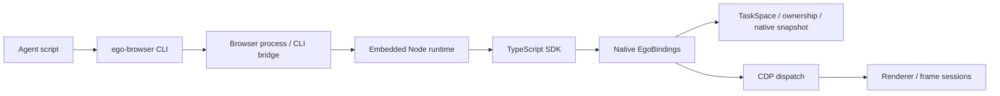

# Ego Lite 동작 분석과 Go CDP 래퍼 재구현 가능성

조사일: 2026-11-07 (Asia/Seoul)

## 결론

**Ego Lite의 에이전트용 브라우저 조작 API는 Go와 표준 CDP로 상당 부분 재구현할 수 있다.** 이동, 입력, 클릭, 대기, 파일 처리보다 개발 비중이 큰 부분은 의미 있는 스냅샷, 안정적인 ref, 프레임별 요소 식별, 입력 전 상태 확인이다. CDP 메서드를 그대로 노출하는 것만으로는 Ego의 사용성을 재현할 수 없다.

이 저장소에는 일반 Chromium에 연결하는 Go 드라이버를 만드는 방향을 권한다. 브라우저 포크 없이 `Task → Page → Snapshot → Ref → Action` 흐름을 제공하고, 스냅샷의 완전한 일치와 Ego의 브라우저 UI 통합은 별도 목표로 둔다. 이번 결과는 공개 소스 분석과 설치된 Ego에서의 동작 관찰이다. **독립 Go 드라이버의 구현·실행 검증은 아직 하지 않았다.**

## 조사 범위와 근거

- 공개 저장소: [`citrolabs/ego-lite`](https://github.com/citrolabs/ego-lite), 조사 revision `bacaece43900e8ca68eea3b6f1663835ea38df9e`.
- 공개 TypeScript SDK, native binding 계약, 스냅샷 요구사항, CLI 아키텍처를 읽었다. 해당 revision의 전체 파일 목록에서 브라우저 엔진의 C++ 구현은 확인하지 못했다. 네이티브 내부 알고리즘은 분석 범위에 포함하지 못했다.
- 로컬 설치 경로에서 확인한 애플리케이션 디렉터리 버전은 `0.5.2.12`다. 공개 소스 revision과 설치된 SDK가 같은 빌드라는 근거는 없다.
- 실제 실험은 새 TaskSpace 하나와 자체 `data:` HTML만 사용했다. 기존 사용자 탭이나 로그인 정보를 조사하지 않았다. 실험 종료 후 생성한 TaskSpace와 페이지를 닫았다.
- Go 환경은 `go1.27.3 windows/arm64`다. 기존 Go 모듈과 의존성은 변경하지 않았다.

문서·소스에서 확인한 사항은 아래에 출처를 붙였다. Go 설계와 구현 순서는 이 조사에 따른 제안이다. 실제 관찰은 별도 절에 기록했다.

## Ego의 실행 구조



CLI가 브라우저 프로세스에 스크립트를 보내면 브라우저가 Node 실행 환경과 `globalThis.ego`를 제공한다. 실제 탭, 프로필, TaskSpace는 브라우저 프로세스가 소유한다. SDK의 CDP 요청도 이 프로세스로 돌아가 공간과 제어권 검사를 거친다. 따라서 공개 SDK는 보통의 Chrome WebSocket에 바로 붙는 독립 드라이버가 아니다. [CLI 아키텍처](https://github.com/citrolabs/ego-lite/wiki/Ego-Browser-CLI-Architecture)

공개 SDK는 다음 책임을 추가한다.

| 계층 | 확인한 책임 | Go에서의 대응 |
| --- | --- | --- |
| TaskSpace / Page | 영속적인 `p1` 라벨, 탭 발견·편입·해제·정리 | 작업별 페이지 레지스트리 |
| Native gate | 선택된 공간에 의존하는 비동기 작업 직렬화 | 명시적인 작업·세션 전달, 필요한 범위의 직렬화 |
| Browser runtime | 요청 ID와 응답 연결, 세션, 이벤트, OOPIF, 네트워크 상태 | CDP 연결 계층과 프레임 관리자 |
| Snapshot / ref | 네이티브 결과 가공, 문서 출처 검사, ref 수명 관리 | AX·DOM·레이아웃 병합과 ref 레지스트리 |
| Resolver / actions | selector 해석, 대상 유일성, 좌표·상태 검사, 입력 | locator·action 계층 |

근거: [Page 모델](https://github.com/citrolabs/ego-lite/blob/bacaece43900e8ca68eea3b6f1663835ea38df9e/package/ego-browser/src/page-model.ts), [native gate](https://github.com/citrolabs/ego-lite/blob/bacaece43900e8ca68eea3b6f1663835ea38df9e/package/ego-browser/src/native-gate.ts), [browser runtime](https://github.com/citrolabs/ego-lite/blob/bacaece43900e8ca68eea3b6f1663835ea38df9e/package/ego-browser/src/browser-runtime.ts).

### 스냅샷은 AX 트리 출력과 다르다

SDK의 기본 스냅샷 수집은 `ego.snapshot()`이라는 네이티브 호출이다. 그 결과를 SDK가 정리하고, 프레임 출처와 locator를 검증한 뒤 페이지 ref를 부여한다. 공개 코드만으로 네이티브 스냅샷 알고리즘을 그대로 옮길 수 있다고 결론 내릴 수 없다. [관찰 드라이버](https://github.com/citrolabs/ego-lite/blob/bacaece43900e8ca68eea3b6f1663835ea38df9e/package/ego-browser/src/driver/observe.ts), [결과 정리](https://github.com/citrolabs/ego-lite/blob/bacaece43900e8ca68eea3b6f1663835ea38df9e/package/ego-browser/src/snapshot-result.ts)

Go에서는 다음 조합으로 유사한 결과를 구성할 수 있다.

1. `Accessibility.getFullAXTree`로 역할, 접근 가능한 이름, 상태와 backend DOM ID를 얻는다.
2. `DOMSnapshot.captureSnapshot` 또는 필요한 DOM·레이아웃 조회로 일반 텍스트, 사각형, 문서 구조를 보충한다.
3. 프레임별 결과를 연결하고 viewport·subtree 범위와 출력 예산을 적용한다.
4. 동작 가능한 노드에 ref를 붙이고 중요하지 않은 래퍼를 축약한다.

이는 구현 제안이다. AX에 없는 콘텐츠, canvas, 닫힌 shadow root, CSS 의사 요소까지 같은 품질로 처리된다는 보장은 없다. `DOMSnapshot.captureSnapshot`의 flattened DOM도 곧바로 에이전트용 의미 트리가 되는 것은 아니다. [Accessibility](https://chromedevtools.github.io/devtools-protocol/tot/Accessibility/), [DOMSnapshot](https://chromedevtools.github.io/devtools-protocol/tot/DOMSnapshot/)

### ref는 번호보다 노드의 출처가 중요하다

공개 코드의 ref 레지스트리는 페이지별로 관리되며 frame, document, backend node의 동일성을 추적한다. 부분 스냅샷은 기존 ref와 병합하고, 전체 스냅샷은 활성 집합을 갱신한다. 문서가 바뀌면 해당 ref를 무효화하고, stale ref를 역할·이름이 비슷한 다른 노드로 대체하지 않는다. 페이지 라벨과 ref 상태는 호출 사이에도 유지하도록 ledger에 저장한다. [ref 레지스트리](https://github.com/citrolabs/ego-lite/blob/bacaece43900e8ca68eea3b6f1663835ea38df9e/package/ego-browser/src/page-ref-registry.ts), [페이지 ledger](https://github.com/citrolabs/ego-lite/blob/bacaece43900e8ca68eea3b6f1663835ea38df9e/package/ego-browser/src/page-ledger.ts)

Go의 식별 키는 최소한 `(browser instance, page, frame, document generation, backendNodeID)`가 필요하다. session 교체도 감지해야 한다. backend node 번호만 전역 키로 쓰면 서로 다른 renderer의 동일 번호를 혼동할 수 있다. 이 충돌과 iframe ref 누락은 Ego의 네이티브 요구사항에도 명시돼 있다. [native snapshot 요구사항](https://github.com/citrolabs/ego-lite/blob/bacaece43900e8ca68eea3b6f1663835ea38df9e/docs/native-snapshot-ref-requirement.md)

첫 구현에서는 탐색·문서 교체·외부 raw CDP 호출 시 ref를 보수적으로 무효화하는 편이 명확하다. 이후 동일 문서의 변경되지 않은 노드에 대해 ref 보존을 확장할 수 있다. 공개 `Page.cdp()`는 조회성 호출도 `finally`에서 기존 ref를 무효화한다. [Page.cdp 구현](https://github.com/citrolabs/ego-lite/blob/bacaece43900e8ca68eea3b6f1663835ea38df9e/package/ego-browser/src/page-model.ts#L2418)

### 클릭과 입력은 여러 단계의 작업이다

클릭은 요소를 유일하게 찾고, 보이는 위치·enabled 상태·hit target을 검사한 다음 `Input.dispatchMouseEvent`를 보낸다. hover로 레이아웃이 바뀔 수 있어 누르기 직전에도 검사하며 iframe 좌표 변환을 처리한다. `fill`은 편집 가능한 실제 컨트롤을 찾고, focus·선택·입력을 수행한 뒤 편집 효과를 확인한다. 일부 input type은 DOM 값 설정과 이벤트를 사용한다. 따라서 모든 입력을 동일한 키보드 경로로 처리하지도 않는다. [액션 구현](https://github.com/citrolabs/ego-lite/blob/bacaece43900e8ca68eea3b6f1663835ea38df9e/package/ego-browser/src/driver/page-actions.ts)

Go에서는 작은 브라우저 측 JavaScript 함수를 `Runtime.callFunctionOn`으로 실행해 상태와 좌표를 모으고, 실제 포인터·텍스트 입력은 CDP로 보내는 구성이 적합하다. 호스트를 Go로 작성해도 페이지 내 JavaScript까지 없앨 필요는 없다. [DOM](https://chromedevtools.github.io/devtools-protocol/tot/DOM/), [Input](https://chromedevtools.github.io/devtools-protocol/tot/Input/)

selector 지원도 별도 작업이다. Ego는 ref, CSS, text, role, href, XPath와 제한적인 Playwright 호환 문법을 해석한다. top document의 사용 가능한 대상을 우선하고, 없으면 프레임을 탐색하며 모호하면 실패한다. 처음에는 ref와 CSS를 완성하고 text·role을 추가하는 순서를 권한다. [요소 resolver](https://github.com/citrolabs/ego-lite/blob/bacaece43900e8ca68eea3b6f1663835ea38df9e/package/ego-browser/src/element-resolver.ts)

### 이벤트와 timeout도 API 계약이다

팝업·다운로드는 트리거 전에 구독해야 한다. 대기 구현과 사용자가 읽는 이벤트 큐를 공유해 서로 이벤트를 소비하지 않게 해야 한다. Ego runtime은 페이지 및 자식 프레임의 네트워크 상태를 지속적으로 추적하고 이벤트 버퍼 크기를 제한한다. OOPIF는 별도 세션으로 붙여야 하며, auto-attach 때 멈춘 target을 재개하는 처리도 필요하다. [browser runtime](https://github.com/citrolabs/ego-lite/blob/bacaece43900e8ca68eea3b6f1663835ea38df9e/package/ego-browser/src/browser-runtime.ts), [Target 프로토콜](https://chromedevtools.github.io/devtools-protocol/tot/Target/)

`context` 취소는 이미 보낸 클릭이나 페이지 JavaScript의 효과를 되돌리지 않는다. Go 드라이버는 명령 전송 전 실패와 전송 후 결과 불명을 구분하고, 후자의 클릭을 자동 재전송하지 않는 계약이 필요하다. Ego도 평가 timeout에 `executionStopped`, `mayHaveLateEffects` 등의 정보를 둔다. [평가 오류 모델](https://github.com/citrolabs/ego-lite/blob/bacaece43900e8ca68eea3b6f1663835ea38df9e/package/ego-browser/src/page-model.ts#L579)

## 기능별 재구현 판단

아래는 프로토콜과 소스를 근거로 한 구현 가능성 판단이다. 구현 완료 목록이 아니다.

| 기능 | 표준 CDP 기반 접근 | 판단 / 남는 차이 |
| --- | --- | --- |
| 이동·reload·URL·title·evaluate | Page, Runtime | 직접 구현 가능 |
| 화면 캡처 | Page.captureScreenshot | 가능. viewport, 전체 화면, clip 처리 필요 |
| 클릭·키보드·fill | DOM, Runtime, Input | 가능. 상태 검사와 컨트롤별 의미 구현 필요 |
| CSS·text·role·ref 선택 | DOM 조회, AX 조회, 페이지 JS, 레지스트리 | 가능. 문법·유일성·접근 가능한 이름 처리가 별도 |
| 의미 스냅샷 | Accessibility + DOMSnapshot + layout | 유사 기능 가능. Ego와 결과·성능 동일성 미검증 |
| iframe·OOPIF | frame tree, Runtime contexts, Target auto-attach | 가능. 수명·세션·좌표 처리가 고난도 |
| 업로드·다운로드·JS dialog | DOM.setFileInputFiles, Browser download 이벤트, Page dialog | 가능. Ego의 일부 legacy Page download 경로는 그대로 복제하지 않을 것 |
| TaskSpace·페이지 라벨·정리 | 드라이버의 작업 상태와 target 레지스트리 | 논리적 작업 공간은 가능. Ego의 브라우저 UI Space와 다름 |
| 작업별 저장소 격리 | Target.createBrowserContext | 가능. 새 incognito 성격의 context이며 기존 로그인 프로필과 다름 |
| 기존 로그인 재사용 | 명시적으로 연결한 지속 프로필 | 조건부 가능. 이미 실행 중인 임의의 기본 Chrome에 자동 연결되는 것은 아님 |
| handoff·사용자 개입 시 즉시 중지 | 드라이버 상태 + 별도 UI/확장 기능 | 협력적 제어 전환은 가능. 표준 CDP만으로 Ego의 UI·네이티브 강제 경계 동일 구현 불가 |
| 에이전트 커서·행동 라벨·OS clipboard | 페이지 overlay 또는 OS별 어댑터 | 대체 구현 가능. 네이티브 UI와 동일하지 않음 |
| Ego 전용 엔진 hook | SDK에 `egoAutomated.enable` 호출 존재 | 표준 Chrome 기능으로 간주할 수 없음 |

다운로드 근거: [Ego 다운로드 코드](https://github.com/citrolabs/ego-lite/blob/bacaece43900e8ca68eea3b6f1663835ea38df9e/package/ego-browser/src/driver/downloads.ts), [Browser 프로토콜](https://chromedevtools.github.io/devtools-protocol/tot/Browser/). 기타 CDP 메서드는 [공식 프로토콜 정의](https://github.com/ChromeDevTools/devtools-protocol/blob/master/json/browser_protocol.json)를 확인했다.

### 작업 공간과 프로필은 분리해야 한다

작업별 탭 묶음과 쿠키·저장소 격리는 다른 개념이다. `TaskSpace = BrowserContext`로 고정하면 같은 로그인 상태를 공유하는 작업을 표현하기 어렵다. `Task`는 소유한 탭과 제어권을 관리하고, 세션 저장소 정책은 기존 context 공유 또는 새 context 생성으로 따로 정하는 것이 적절하다. [Target.createBrowserContext](https://chromedevtools.github.io/devtools-protocol/tot/Target/#method-createBrowserContext)

Chrome 136부터 일반 Chrome의 기본 데이터 디렉터리에서는 remote-debugging port와 pipe 플래그가 적용되지 않는다. 전용 `user-data-dir`로 시작한 지속 프로필에 사용자가 로그인하거나, 미리 디버깅을 허용한 브라우저에 연결하는 흐름을 설계해야 한다. Ego가 제공하는 기존 로그인 경험이 일반 CDP 연결만으로 자동 재현되는 것은 아니다. [Chrome 공식 변경 안내](https://developer.chrome.com/blog/remote-debugging-port)

## 설치된 Ego에서 직접 확인한 결과

자체 HTML은 label/input, 결과 output을 갱신하는 button, open shadow root의 button, `srcdoc` iframe의 button으로 구성했다. 여러 `ego-browser nodejs` 호출에서 같은 TaskSpace와 `p1`을 재사용했다.

| 실험 | 관찰 |
| --- | --- |
| 최초 snapshot | textbox `@1`, 일반 button `@2`, shadow button `@3`, iframe `@4`, iframe button `@5`가 출력됨 |
| 다음 CLI 호출에서 `fill('@1', ...)`, `click('@2')` | output의 값이 `Go CDP feasible`로 바뀜. 호출 간 페이지와 ref 재사용 확인 |
| 입력 후 snapshot | 기존 노드의 ref는 유지되고 새 output에 `@6` 부여 |
| `page.cdp('Accessibility.getFullAXTree')` | 21개 노드 반환. 조회한 기본 결과의 controls에는 textbox와 top document/shadow button이 있고 iframe button은 없음 |
| 위 raw CDP 직후 `click('@2')` | `Stale ref: @2; take a new snapshot`으로 거절 |
| `snapshot({scope:'subtree', root:'@4'})` | iframe subtree와 그 안의 button ref 반환 |
| shadow `@3`와 iframe `@5` 클릭 | 각 click handler가 설정한 `shadowClicked`, `frameClicked` 값 모두 `yes` 확인 |
| `task.cdp('Browser.getVersion')` | `'Browser.getVersion' wasn't found` 오류. 같은 공간을 재개해 나머지 실험 수행 |
| 종료 | `finish({keep:[]})` 결과 공간과 `p1`이 닫히고 보존한 unmanaged tab은 0개 |

AX 결과 관찰은 이 호출과 fixture에 한정한다. iframe이 AX에 원천적으로 접근 불가능하다는 뜻이 아니다. 프레임별 명시 조회·순회가 필요한 이유를 보여 준다. 이번 iframe은 `srcdoc`이며 **cross-origin OOPIF 실험은 하지 않았다.**

문서와 설치 버전의 차이도 있었다. native binding 문서에는 `Browser.getVersion` 예시가 있으나 실제 호출은 실패했다. subtree 결과에는 `loc=unstable`이 출력됐지만 조사한 공개 소스의 계약은 이런 locator를 제거하도록 되어 있었다. 이 결과로 모든 Browser 도메인이 미지원이라고 일반화할 수는 없다. 버전별 capability 확인이 필요하다. [native API 문서](https://github.com/citrolabs/ego-lite/blob/bacaece43900e8ca68eea3b6f1663835ea38df9e/docs/native-bindings-api.md)

대표 관찰값:

```text
AFTER_INPUT {"receipt":{},"result":"Go CDP feasible"}
RAW_CDP_REF {"message":"Stale ref: @2; take a new snapshot"}
FRAME_AND_SHADOW {"shadowClicked":"yes","frameClicked":"yes"}
```

재현 시에는 새 TaskSpace를 만들고 ID를 기록한 뒤 다음 호출에서 그 ID를 사용한다. ref 번호는 새 스냅샷에서 읽어야 한다. 위 번호와 테스트 공간 ID를 다른 실행에 고정해서는 안 된다. PowerShell에서는 UTF-8 `.mjs`에 스크립트를 저장하고 다음 형태로 실행했다.

```powershell
ego-browser nodejs -e "await import('file:///C:/absolute/path/probe.mjs')"
```

이 실험으로 대규모 사이트 호환성, 속도, 토큰 절감, OS 간 동등성은 검증하지 않았다.

## Go 구현 방향

### 하부 CDP는 기존 Go 구현을 활용한다

초기에는 `chromedp`와 `cdproto`를 하부 계층으로 사용하고, 프로젝트 고유의 snapshot·ref·locator·action 의미를 그 위에 구현하는 구성을 권한다. WebSocket framing이나 CDP 타입 생성부터 다시 작성할 필요는 없다. 상위 API가 라이브러리 내부 타입을 노출하지 않게 하면 교체 비용을 줄일 수 있다.

조사일 GitHub latest release는 `chromedp v0.23.0`이고, 해당 `go.mod`는 Go 1.25 이상과 `cdproto v0.159.0`을 사용한다. 이 버전은 오래된 예제와 API가 다르다. 원격 연결은 `remote.NewAllocator`, 명령은 typed `cdp.Call`, action은 `Do`/`Run` 구조를 확인했다. 실제 도입 전에는 버전을 고정하고 연결·취소·프레임 동작을 먼저 검증해야 한다. [v0.23.0 README](https://github.com/chromedp/chromedp/blob/v0.23.0/README.md), [go.mod](https://github.com/chromedp/chromedp/blob/v0.23.0/go.mod), [API](https://github.com/chromedp/chromedp/blob/v0.23.0/docs/API.md), [remote allocator](https://github.com/chromedp/chromedp/blob/v0.23.0/remote/allocator.go)

`go-rod/rod`도 CDP 기반 대안이며 자동 대기와 iframe 지원을 제공한다. 다만 기존 라이브러리의 클릭·대기 의미를 그대로 노출하면 Ego식 계약과 충돌할 수 있으므로 실험으로 판단해야 한다. 조사일 latest release는 `v0.116.2`였으며 release 날짜만으로 유지보수 상태를 단정하지 않았다. [Rod README](https://github.com/go-rod/rod/blob/v0.116.2/README.md)

### 권장 책임 분리

아래는 설계안이며 아직 생성한 Go 패키지는 없다.

| 구성 | 책임 |
| --- | --- |
| 공개 Browser / Task / Page API | 연결, 작업·페이지 수명, context 기반 deadline |
| CDP 어댑터 | 요청·응답, 구독, 세션 attach/detach, 연결 종료 |
| frame 관리자 | frame tree, execution context, OOPIF session, 문서 세대 |
| snapshot 구성기 | AX·DOM 병합, viewport·subtree, 축약, 출력 예산 |
| ref 레지스트리 | 페이지·프레임·문서 출처, stale 검사 |
| locator / action | 유일한 대상 선택, 상태·좌표 검사, 입력, receipt |
| 작업 상태 저장 | CLI 호출 간 페이지 라벨·제어권 보존이 필요할 때 도입 |

Go 라이브러리를 한 프로세스에서 쓰는 첫 단계에는 daemon이나 영속 ledger가 필수는 아니다. 별도 CLI 호출 간 세션 유지가 요구되면 장기 실행 Go 프로세스가 연결과 작업 상태를 소유하도록 확장할 수 있다. 이때 작업별 입력은 순서대로 수행하고 서로 다른 target의 조회는 병렬화할 수 있다. Ego의 전역 선택 공간 때문에 필요한 gate를 모든 브라우저에 그대로 복제할 필요는 없다.

호스트를 Go SDK로 바꾸는 것과 기존 `ego-browser nodejs` 스크립트를 그대로 실행하는 것은 별개다. Go 호출자가 조건문·반복·여러 액션을 구성하는 데에는 Node가 필요하지 않다. 기존 JavaScript 스크립트와 Node 모듈까지 호환하려면 추가 실행 환경과 비동기 binding이 필요하므로 초기 CDP 래퍼 범위에서는 제외하는 것이 적절하다. 페이지 안에서 실행할 JavaScript 함수는 CDP로 전달하면 된다.

raw CDP escape hatch도 작업 정책을 통과해야 한다. 브라우저 수준 명령과 임의 페이지 코드를 허용하면서 탭 레지스트리만으로 강한 격리를 보장할 수는 없다. handoff 시 새로운 작업을 차단하는 협력적 제어와 브라우저가 강제하는 사용자 제어권을 구분해서 문서화해야 한다.

### 먼저 만들고 검증할 순서

1. **연결과 수명:** 허용된 CDP endpoint 연결, 탭 생성·attach·정리, 이벤트 구독, 요청 timeout. 외부에서 연결한 브라우저와 사용자 탭을 종료하지 않는지 확인한다.
2. **한 문서의 핵심 루프:** snapshot → ref → fill/click → 명시적인 결과 확인. 기본 텍스트·역할·상태와 CSS/ref를 지원한다.
3. **실패 계약:** 중복 selector, 가려진·disabled 요소, navigation 직후 stale ref, 전송 후 timeout을 구분한다. stale ref로 유사한 다른 요소를 클릭하지 않아야 한다.
4. **프레임:** same-process iframe에서 시작해 두 origin의 OOPIF, nested iframe, 프레임 탐색·분리, 동일 backend ID 충돌, open shadow DOM으로 넓힌다. 좌표와 ref가 정확한 대상에 도달하는지 확인한다.
5. **이벤트와 파일:** popup·download를 먼저 구독하고 trigger, dialog 처리, 파일 chooser 및 완료·취소를 검증한다.
6. **협업·지속 실행:** 실제 필요에 따라 페이지 라벨 영속화, 작업별 프로필 정책, handoff UI와 재개 계약을 추가한다.

우선 타당성 판단 기준은 일반 Chrome에서 2번과 3번을 통과하고, 4번의 cross-origin OOPIF에서 노드 오인 없이 동작하는 것이다. 이것을 통과해야 Ego와 유사한 에이전트용 Go 드라이버의 핵심이 검증됐다고 말할 수 있다. 성능 수치는 그 뒤 같은 fixture·브라우저·작업으로 비교해야 한다.

## 남는 한계와 라이선스

공개 저장소에는 MIT 라이선스가 있다. 공개 코드를 복사하거나 실질적인 부분을 옮길 경우 저작권과 라이선스 고지를 유지해야 한다. 이 라이선스가 공개되지 않은 네이티브 구현의 제공이나 재사용 가능성을 입증하는 것은 아니다. 이 문서는 코드를 이식하지 않고 동작과 설계를 분석했다. [LICENSE](https://github.com/citrolabs/ego-lite/blob/bacaece43900e8ca68eea3b6f1663835ea38df9e/LICENSE)

최종 판단은 **일반 Chromium용 Go CDP 드라이버로 추진 가능**이다. 핵심 투자는 snapshot·ref·frame·action 의미에 두고, Ego의 브라우저 UI, 네이티브 스냅샷과 완전한 동등성은 추가 구현·실험 없이 약속하지 않는 것이 타당하다.
